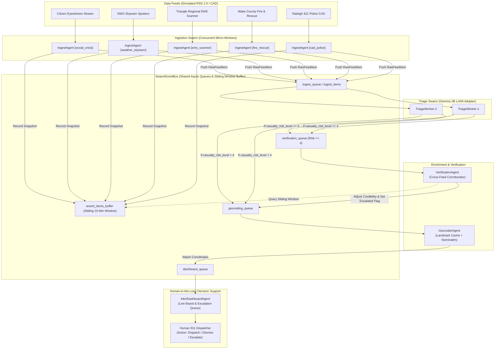

# SentinelSentry: Multi-Agent Swarm Architecture

`SentinelSentry` deploys a swarm of specialized, concurrent agents that ingest, triage, cross-corroborate, geocode, and escalate crisis incidents from noisy emergency feeds for a human 911/emergency dispatcher.

---

## 1. System Swarm Architecture



---

## 2. Agent Catalog & Responsibilities

### 2.1 Ingest Agents (`IngestAgent`)
- **Source File:** [`sentinelsentry/agents/ingest.py`](file:///C:/Users/david/src/--misc/mlhossai/sentinelsentry/agents/ingest.py)
- **Class:** [`IngestAgent`](file:///C:/Users/david/src/--misc/mlhossai/sentinelsentry/agents/ingest.py#L16-L53)
- **Deployment:** 1 independent worker per feed channel (designed for Maritime micro-VM isolation).
- **Core Loop:**
  1. Periodically polls the feed (HTTP endpoint or in-process memory stream).
  2. Passes incoming items to a bounded LRU [`DeduplicationCache`](file:///C:/Users/david/src/--misc/mlhossai/sentinelsentry/feeds/client.py#L20-L36) using GUID or content SHA-256 hash.
  3. Records unseen items into the `recent_items_buffer` (for multi-feed corroboration).
  4. Pushes [`RawFeedItem`](file:///C:/Users/david/src/--misc/mlhossai/sentinelsentry/schema.py#L68-L82) to `bus.ingest_queue`.

### 2.2 Triage Agents (`TriageAgent`)
- **Source File:** [`sentinelsentry/agents/triage.py`](file:///C:/Users/david/src/--misc/mlhossai/sentinelsentry/agents/triage.py)
- **Class:** [`TriageAgent`](file:///C:/Users/david/src/--misc/mlhossai/sentinelsentry/agents/triage.py#L130-L162) & [`LocalTriageEngine`](file:///C:/Users/david/src/--misc/mlhossai/sentinelsentry/agents/triage.py#L18-L127)
- **Deployment:** Scalable worker pool (`TriageWorker-1`, `TriageWorker-2`, etc.).
- **Inference Pipeline:**
  - Formats raw messy dispatch text with `<start_of_turn>user\n...<end_of_turn>` using [`format_gemma_prompt`](file:///C:/Users/david/src/--misc/mlhossai/sentinelsentry/data/prompt_template.py#L29-L37).
  - Executes Gemma 2B LoRA adapter inference (`adapter_model.safetensors`).
  - Falls back to high-precision deterministic parsing engine if running in resource-constrained or offline environments.
  - Strictly validates against the [`TriageOutput`](file:///C:/Users/david/src/--misc/mlhossai/sentinelsentry/schema.py#L25-L65) schema:
    - `incident_type` (e.g., *Structure Fire*, *Vehicle Accident / Rescue*, *Severe Weather / Flooding*)
    - `casualty_risk_level` (1 to 5)
    - `credibility_score` (0.0 to 1.0)
    - `location_text` (normalized street/intersection/landmark)
- **Routing Decision:**
  - If `casualty_risk_level >= 4`: Routes immediately to `verification_queue`.
  - If `casualty_risk_level < 4`: Routes to `geocoding_queue` as routine priority.

### 2.3 Verification Agent (`VerificationAgent`)
- **Source File:** [`sentinelsentry/agents/verification.py`](file:///C:/Users/david/src/--misc/mlhossai/sentinelsentry/agents/verification.py)
- **Class:** [`VerificationAgent`](file:///C:/Users/david/src/--misc/mlhossai/sentinelsentry/agents/verification.py#L18-L115)
- **Trigger:** Only executed when `casualty_risk_level >= 4` (high casualty risk or life-threat).
- **Corroboration Logic:**
  1. Inspects the sliding 10-minute window of recent items (`recent_items_buffer`).
  2. Filters for candidates from **different** feeds (`candidate.feed_id != item.feed_id`).
  3. Computes intersection of location tokens and scenario identifiers.
  4. **Score Adjustment:**
     - Official CAD/Fire/EMS corroboration: adds `+0.25` confidence delta.
     - Social/eyewitness corroboration: adds `+0.15` confidence delta.
     - Maximum credibility capped at `1.0`.
  5. **Auto-Escalation:** If verified credibility $\ge 0.60$ and risk $\ge 4$, marks `incident.is_escalated = True` and sets `incident.human_status = "ESCALATED"`.
  6. Emits [`CorroborationReport`](file:///C:/Users/david/src/--misc/mlhossai/sentinelsentry/schema.py#L96-L109) with cross-stream evidence and passes to `geocoding_queue`.

### 2.4 Geocoder Agent (`GeocoderAgent`)
- **Source File:** [`sentinelsentry/agents/geocoder.py`](file:///C:/Users/david/src/--misc/mlhossai/sentinelsentry/agents/geocoder.py)
- **Class:** [`GeocoderAgent`](file:///C:/Users/david/src/--misc/mlhossai/sentinelsentry/agents/geocoder.py#L38-L100)
- **Resolution Strategy:**
  1. Checks in-memory cache for previously resolved strings.
  2. Queries local landmark dictionary [`LOCAL_LANDMARK_CACHE`](file:///C:/Users/david/src/--misc/mlhossai/sentinelsentry/agents/geocoder.py#L16-L35) for instant zero-latency resolution of known regional landmarks (e.g. *1200 S Saunders St*, *I-40 EB MM 287*, *Crabtree Valley Mall*).
  3. Optionally queries OpenStreetMap Nominatim API if network access is enabled.
  4. Returns [`GeocodedLocation`](file:///C:/Users/david/src/--misc/mlhossai/sentinelsentry/schema.py#L85-L93) and forwards to `dashboard_queue`.

### 2.5 Alert & Dashboard Agent (`AlertDashboardAgent`)
- **Source File:** [`sentinelsentry/agents/dashboard.py`](file:///C:/Users/david/src/--misc/mlhossai/sentinelsentry/agents/dashboard.py)
- **Class:** [`AlertDashboardAgent`](file:///C:/Users/david/src/--misc/mlhossai/sentinelsentry/agents/dashboard.py#L18-L115)
- **Role:** Pure **decision support** for human dispatchers; not autonomous response.
- **Output:**
  - Maintains state sorted by escalation flag and risk level.
  - Renders live ANSI/Rich decision board table with color-coded severity meters, credibility ratings, and cross-feed corroboration traces.
  - Tracks aggregate swarm metrics: Total Processed, Corroborated Cross-Feed, Escalated Alerts, and Routine Review counts.

---

## 3. Communication & Coordination Protocols

The swarm provides two distinct execution modes via [`SwarmCoordinator`](file:///C:/Users/david/src/--misc/mlhossai/sentinelsentry/agents/base.py#L54-L115):

```python
from sentinelsentry.agents.base import SwarmEventBus, SwarmCoordinator

bus = SwarmEventBus()
coordinator = SwarmCoordinator(bus=bus)

# Register agents
coordinator.register_ingest_agent(ingest_fire)
coordinator.register_ingest_agent(ingest_police)
coordinator.register_triage_worker(triage_worker)
coordinator.set_verification_agent(verification_agent)
coordinator.set_geocoder_agent(geocoder_agent)
coordinator.set_dashboard_agent(dashboard_agent)
```

### Mode A: Discrete Simulation (`step()` & `drain()`)
- Processes batches deterministically without relying on network sockets or background tasks.
- Perfect for automated unit tests, reproducible evaluations on the 100-sample test set, and fast offline demonstrations.

### Mode B: Asynchronous Concurrent Tasks (`start()` & `stop()`)
- Uses independent `asyncio.Task` workers communicating through async queues.
- Models deployment inside micro-VMs (e.g., Maritime / Docker containers) with parallel RSS stream polling.

---

## 4. End-to-End Incident Lifecycle

1. **Broadcast:** An incident occurs (e.g., commercial fire at 1200 S Saunders St).
2. **Ingest:**
   - `cad_police` feed emits: `"10-70 COMM BLDG 1200 S SAUNDERS ST. FLAMES VISIBLE ROOF 1 SUBJ INSIDE"`.
   - `social_crisis` feed emits: `"Holy smoke huge explosions warehouse Saunders St downtown Raleigh sirens everywhere!!"`.
3. **Triage:** Gemma 2B LoRA extracts:
   ```json
   {
     "incident_type": "Structure Fire",
     "casualty_risk_level": 4,
     "credibility_score": 0.90,
     "location_text": "1200 S Saunders St, Raleigh"
   }
   ```
4. **Verification Trigger:** Because `casualty_risk_level == 4`, `VerificationAgent` searches recent feeds, identifies the corroborating citizen post on Saunders St within the 10-minute window, boosts credibility to `0.95`, and sets `is_escalated = True`.
5. **Geocoding:** `GeocoderAgent` pins the location to `(35.7592, -78.6534)`.
6. **Alert:** The human dispatcher's board lights up with an urgent `[** ESCALATED **]` alert showing both corroborating streams for rapid dispatch decision support.
