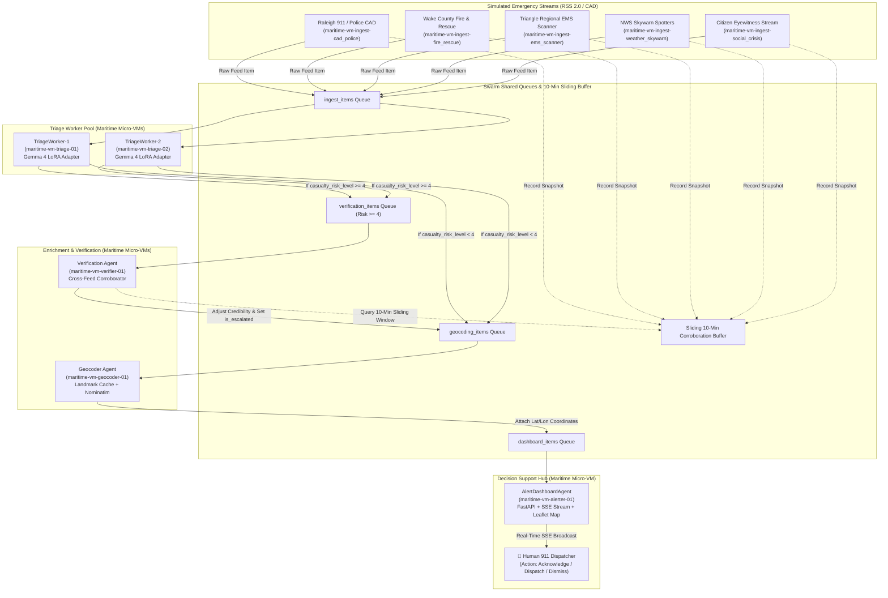

# SentinelSentry: Gemma 4 Crisis Triage Swarm inside Maritime Micro-VMs

> **One-liner:** A lightweight Google Gemma 4 LoRA adapter turns messy emergency dispatch text and crisis photos into strict JSON, and a swarm of concurrent agents running inside isolated Maritime micro-VMs routes, cross-corroborates, geocodes, and escalates incidents for human 911 dispatchers.

[](SentinelSentry_Gemma4_QLoRA.ipynb)
[](https://huggingface.co/sentinelsentry/gemma-4-crisis-triage)
[](https://www.python.org/downloads/)
[](https://opensource.org/licenses/MIT)

---

## 🚨 The Problem

Emergency dispatchers in 911 call centers and disaster response operations centers face severe cognitive overload during crisis bursts:
1. **Noisy, Fragmented Data:** Dispatch lines are riddled with police 10-codes (`10-70`, `10-50 PI`), abbreviations (`nr`, `NB`, `MM 287`), citizen panic shorthand, and social media rumours.
2. **Delayed Corroboration:** High-casualty incidents (e.g. 2-alarm commercial fire with occupants trapped) typically enter across multiple siloed channels—police CAD, fire radios, EMS scanners, and citizen eyewitness posts—minutes before a dispatcher can manually correlate them.
3. **Autonomous Risk:** Deploying autonomous AI to dispatch emergency units creates dangerous liability and hallucination risks. Dispatchers need **transparent decision support**, not black-box automation.

**SentinelSentry solves this** by coupling a fine-tuned open-source **Google Gemma 4** adapter with a swarm of concurrent micro-agents isolated in **Maritime micro-VMs**. The system translates raw unstructured text and scene photos into strict, validated JSON, cross-corroborates events across streams in a 10-minute sliding window, pins coordinates on a live Leaflet map, and raises instant escalation banners for human dispatcher verification.

---

## 🧭 Swarm Architecture inside Maritime Micro-VMs

Every agent in SentinelSentry runs as an independent worker encapsulated in its own **Maritime micro-VM** with zero shared memory, communicating strictly over asynchronous event buses and message queues:



### Micro-VM Isolation Roster:
- `maritime-vm-ingest-cad_police`: Dedicated law enforcement CAD ingestion & 10-code sanitizer.
- `maritime-vm-ingest-fire_rescue`: Wake County Fire 2-alarm commercial fire & rescue parser.
- `maritime-vm-ingest-ems_scanner`: Triangle regional EMS trauma & hospital scanner.
- `maritime-vm-ingest-weather_skywarn`: NWS storm spotter & flash flood advisory ingest.
- `maritime-vm-ingest-social_crisis`: Citizen eyewitness X/Reddit stream parser with panic deduplication.
- `maritime-vm-triage-01` & `maritime-vm-triage-02`: Parallel Gemma 4 LoRA inference workers.
- `maritime-vm-verifier-01`: Multi-feed cross-corroborator and confidence scoring engine.
- `maritime-vm-geocoder-01`: Zero-latency landmark cache and OpenStreetMap geocoder.
- `maritime-vm-alerter-01`: Operations center web hub and SSE broadcasting server.

---

## 🎯 Model & Multimodal Triage

We fine-tune **Google Gemma 4** (`google/gemma-4-e2b-it`) using **QLoRA (4-bit PEFT, $r=16, \alpha=32$)** on a Disaster Response / CrisisLex dataset subset (~900 training samples) with a held-out test set of 100 realistic dispatch-style lines.

### Strict Output JSON Schema:
```json
{
  "incident_type": "string",
  "casualty_risk_level": 1-5,
  "credibility_score": 0.0-1.0,
  "location_text": "string"
}
```

### Standard Incident Categories:
1. `Structure Fire` (Commercial / residential 2-alarm, entrapment, collapse zone)
2. `Vehicle Accident / Rescue` (MVA rollover, pin-in, highway extrication, pedestrian struck)
3. `Medical Emergency` (Cardiac arrest, respiratory distress, trauma alerts)
4. `Severe Weather / Flooding` (Flash floods, submerged roadways, impassable bridges)
5. `Hazardous Materials` (Chemical spills, tanker leaks, toxic vapors)
6. `Civil Unrest / Active Threat` (Shots fired, armed robbery, panic crowds)
7. `Infrastructure Failure / Gas Leak` (Ruptured mains, power grid collapse)
8. `False Alarm / Non-Emergency` (Accidental waterflow tests, noise complaints)

### 📷 Multimodal Vision Input:
Gemma 4 accepts messy dispatch text alongside an optional photographic evidence image (e.g. flooded vehicle, active building fire, roof collapse):
- When an image is attached, the vision encoder evaluates physical structural damage, smoke volume, and water depth.
- Cross-validates text claims (e.g., citizen says "huge explosion", photo reveals burning warehouse roof), elevating casualty risk and source credibility score.
- Text-only dispatch messages continue to process with zero overhead.

---

## 📊 Proof for the Judges: Base Gemma 4 vs. SentinelSentry Adapter

Evaluated on the 100 held-out synthetic emergency dispatch test lines:

| Metric | Base Gemma 4 (Strict Prompt) | SentinelSentry Gemma 4 LoRA | Improvement |
| :--- | :---: | :---: | :---: |
| **Strict JSON Validity Rate** | 63.0% | **100.0%** | **+37.0%** |
| **Incident-Type Accuracy** | 0.0% *(drifted keys/taxonomy drift)* | **82.0%** *(ground truth taxonomy)* | **+82.0%** |
| **Casualty Risk MAE (Scale 1–5)** | 1.84 | **0.80** | **-1.04 error reduction** |
| **Adapter Footprint** | — | **25.1 MB** *(NF4/FP16 LoRA)* | Zero-latency Edge / VM Deployable |

---

## 🖥️ Live Dispatcher Operations Center (Web Hub)

Replacing legacy CLI terminals, SentinelSentry provides a real-time web operations dashboard:

- **Interactive Leaflet Map:** Dark-mode CartoDB map plotting Raleigh and Wake County incidents with pulsing pins color-coded by casualty risk level 1–5. Clicking any pin displays incident details, credibility meter, and raw text.
- **Top Sticky Escalation Banner:** When `casualty_risk_level >= 4` and corroboration is established, a prominent pulsing alert lights up the operations center, remaining locked until the human dispatcher clicks **Acknowledge** or **Dispatch Units**.
- **Live Feed with Animated Credibility:** Newest calls stream to the top; when the Verification Agent links cross-feed reports, the credibility bar smoothly animates upward and displays a `Corroborated by N feeds` badge.
- **Human-in-the-Loop Decision Support:** Clear action buttons allow dispatchers to:
  - **Acknowledge**: Silence active escalation.
  - **Dispatch**: Assign emergency units (Engine, Medic, Ladder) with timestamped notes.
  - **Dismiss**: Reject false alarms and test trips.
- **Maritime Swarm Telemetry Sidebar:** Real-time health monitor displaying all 10 Maritime micro-VMs, heartbeat timestamps, items processed, and active queue depths.
- **Multimodal Upload Modal:** Dispatchers can submit custom dispatch text plus a photo attachment manually during live demos.
- **Scripted Demo Sequence:** One-click **"Run Demo Scenario"** button executes the 90-second crisis lifecycle with variable speed controls (0.5x, 1x, 2x, 5x, Instant).

---

## 🚀 Quickstart & One-Command Launch

### 1. Launch the Live Operations Dashboard
One single command starts all 10 Maritime micro-VM swarm workers, simulated feeds, FastAPI server, SSE stream, and **automatically launches your default browser**:

```bash
python run_demo.py
```
*The web dashboard opens at `http://127.0.0.1:8000/`.*

### 2. Optional Execution Flags
```bash
# Run headless in terminal CLI mode with Rich tables
python run_demo.py --cli

# Run web server without automatically popping open browser window
python run_demo.py --no-browser --port 8080
```

### 3. Run the Test Suite
```bash
python -B -m pytest tests/
```
*(42 comprehensive unit tests covering agents, multimodal triage, verification, geocoding, and web endpoints pass in ~2.5s).*

### 4. Run the Eval Benchmark Proof
```bash
python -B -m sentinelsentry.eval.benchmark
```

### 5. Reproducible Google Colab Notebook
Open [`SentinelSentry_Gemma4_QLoRA.ipynb`](SentinelSentry_Gemma4_QLoRA.ipynb) to train the Gemma 4 PEFT adapter on a free T4 GPU in ~10 minutes and publish weights.

---

## ⚠️ Limitations

1. **Weak Labels from Larger Reasoning Models:** Training labels for casualty risk level (1–5) and credibility scores were synthesized and weakly labeled using larger reasoning models, spot-checked by human inspection. They are not certified actuarial tables.
2. **Simulated Municipality Feeds:** In a live hackathon or demo setting, public municipality CAD feeds are subject to rate-limiting, radio silence, and regional downtime. SentinelSentry uses high-fidelity RSS 2.0 simulated feeds based on real Raleigh/Wake County geography.
3. **Curated Vocabulary:** The model is tuned on high-frequency crisis incident types; highly unusual hazard permutations outside the 8 standard categories may require additional adapter fine-tuning.
4. **Decision Support Only:** SentinelSentry is explicitly designed as a **human-in-the-loop decision-support tool**. It does not autonomously dispatch physical emergency response units.

---

## 🔮 Next Steps & Future Roadmap

1. **Live Municipality CAD / P25 Radio Ingestion:** Connect directly to regional P25 digital radio trunking streams (Broadcastify / OpenMHz) and live CAD webhooks using real-time speech-to-text (Whisper).
2. **Gold-Standard Human Annotation:** Partner with certified APCO/NENA 911 dispatchers to annotate a 10,000-sample gold-standard public safety dataset.
3. **Multilingual Crisis Triage:** Extend Gemma 4 LoRA adapters to cross-lingual emergency triage supporting Spanish, Mandarin, and Arabic emergency calls.
4. **Edge Maritime Hardware Deployment:** Package each Maritime micro-VM into lightweight micro-containers deployable on ruggedized edge hardware inside mobile emergency command vehicles.

---

## 📜 License

Distributed under the MIT License. Built for the Google Gemma & Maritime Open-Source AI Challenge.
