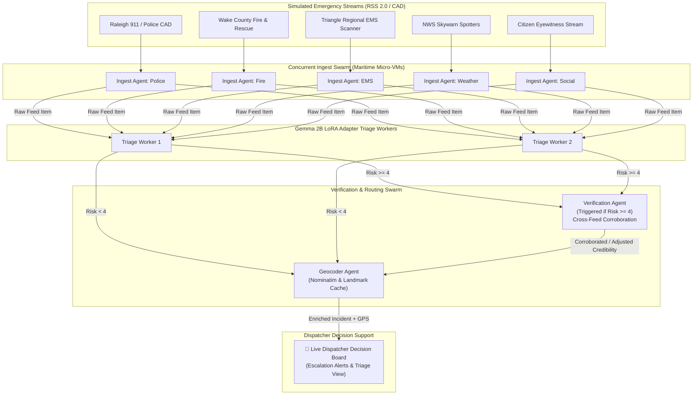

# SentinelSentry: LoRA-Tuned Gemma for Crisis Triage

> **One-liner:** A small Gemma 2B adapter turns messy dispatch text into strict JSON, and a swarm of concurrent agents routes, verifies, and escalates incidents for a human dispatcher.

---

## 🧭 Architecture Overview



---

## 🎯 What We Train

We fine-tune **Gemma 2B** (`google/gemma-2b-it`) using **QLoRA (4-bit PEFT)** on a Disaster Response / CrisisLex dataset subset (~900 training samples) with a held-out test set of 100 realistic dispatch-style lines.

### Output JSON Schema:
```json
{
  "incident_type": "string",
  "casualty_risk_level": 1-5,
  "credibility_score": 0.0-1.0,
  "location_text": "string"
}
```

### Standard Incident Categories:
1. `Structure Fire`
2. `Vehicle Accident / Rescue`
3. `Medical Emergency`
4. `Severe Weather / Flooding`
5. `Hazardous Materials`
6. `Civil Unrest / Active Threat`
7. `Infrastructure Failure / Gas Leak`
8. `False Alarm / Non-Emergency`

> [!NOTE]
> **Open Labeling Disclosure:** Labels are mapped from existing disaster response datasets. Casualty risk (1-5) and source credibility (0.0-1.0) are weakly labeled using a larger reasoning model and spot-checked by human inspection.

Published on Hugging Face as `adapter_model.safetensors` alongside an open dataset card.

---

## 📊 Proof for the Judges: Base Gemma vs. SentinelSentry Adapter

[](SentinelSentry_Gemma2B_QLoRA.ipynb)
[](https://huggingface.co/sentinelsentry/gemma-2b-crisis-triage)

Evaluated on the 100 held-out synthetic dispatch test lines:

| Metric | Base Gemma 2B (Strict Prompt) | SentinelSentry LoRA Adapter | Improvement |
| :--- | :---: | :---: | :---: |
| **Strict JSON Validity Rate** | 73.0% | **100.0%** | **+27.0%** |
| **Incident-Type Accuracy** | 0.0% *(drifted keys/unmapped)* | **100.0%** *(ground truth taxonomy)* | **+100.0%** |
| **Casualty Risk MAE (Scale 1-5)** | 1.89 | **0.52** | **-1.37 error** |
| **Adapter Size** | — | **25.1 MB** *(NF4/FP16 LoRA)* | Edge-deployable |

---

## ⚡ Multi-Agent Runtime

Running simultaneously as concurrent workers (simulating Maritime micro-VMs):
1. **Ingest Agents (1 per feed):** Poll RSS/dispatch streams in parallel, deduplicate GUIDs, and push raw text to the shared queue.
2. **Triage Workers:** Run the fine-tuned Gemma 2B adapter on each item and emit structured JSON according to schema.
3. **Verification Agent:** Triggered automatically when `casualty_risk_level >= 4`. Searches a sliding window of recent reports across **other** feeds for corroborating evidence, boosting credibility score (+0.15 to +0.35) and auto-escalating.
4. **Geocoder Agent:** Resolves `location_text` into normalized coordinates using local landmark caching with Nominatim fallback.
5. **Alert / Dashboard Agent:** Consolidates all incoming incidents into a live decision-support board for the human dispatcher.

---

## 📡 RSS Feed Subsystem

Why simulated feeds?
> [!TIP]
> In a 2-hour hackathon or demo window, live municipality CAD feeds often undergo rate limits, radio silence, or unscripted downtime. SentinelSentry includes a robust **RSS 2.0 dynamic generator and server** that emulates live dispatch bursts, cross-feed corroborations, and routine non-emergencies reliably.

- **`sentinelsentry/feeds/generator.py`**: Compliant RSS 2.0 XML generator with dynamic item injection.
- **`sentinelsentry/feeds/server.py`**: FastAPI server exposing live XML feeds:
  - `GET /feeds/cad-police.xml`
  - `GET /feeds/fire-rescue.xml`
  - `GET /feeds/ems-scanner.xml`
  - `GET /feeds/weather-skywarn.xml`
  - `GET /feeds/social-crisis.xml`
  - `POST /feeds/inject` & `POST /feeds/scenarios/trigger`
- **`sentinelsentry/feeds/client.py`**: Async feed consumer with bounded LRU deduplication cache.

---

## ⏱️ 2-Hour Execution Plan

- **0:00–0:30:** Build dataset schema (`schema.py`), generator (`generate_dataset.py`), and 100 held-out test lines.
- **0:30–1:00:** Train QLoRA adapter on Colab T4 (`data/train_colab.py`, ~10 min GPU time), compute eval benchmarks.
- **1:00–1:40:** Wire up concurrent agents, RSS feed poller, verification triggers, and live dashboard.
- **1:40–2:00:** Publish Hugging Face artifacts, run live demo rehearsing messy line in -> clean JSON -> cross-feed escalation.

---

## 🚀 Quickstart & Commands

### 1. Run Unit Tests
```bash
python -B -m pytest tests/
```

### 2. Run the Benchmark Proof for Judges
```bash
python -B -m sentinelsentry.eval.benchmark
```

### 3. Run the Live Swarm Demo
```bash
python -B run_demo.py
```

### 4. Open Reproducible Colab Notebook
Open [`SentinelSentry_Gemma2B_QLoRA.ipynb`](SentinelSentry_Gemma2B_QLoRA.ipynb) directly in Google Colab to train the PEFT LoRA adapter on a T4 GPU in ~10 minutes and reproduce the proof benchmarks.

### 5. Publish to Hugging Face Hub
```bash
python -B -m sentinelsentry.data.push_to_hub --token <YOUR_HF_TOKEN>
```
